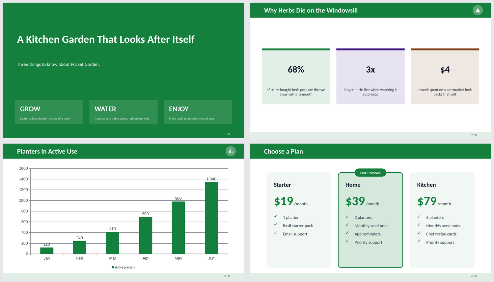
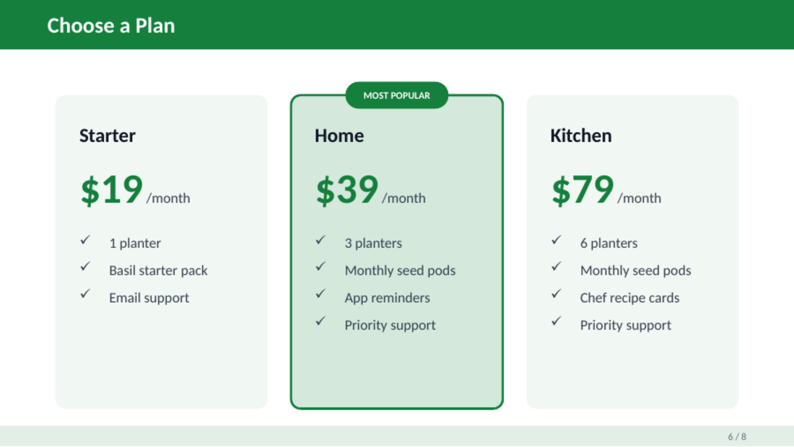
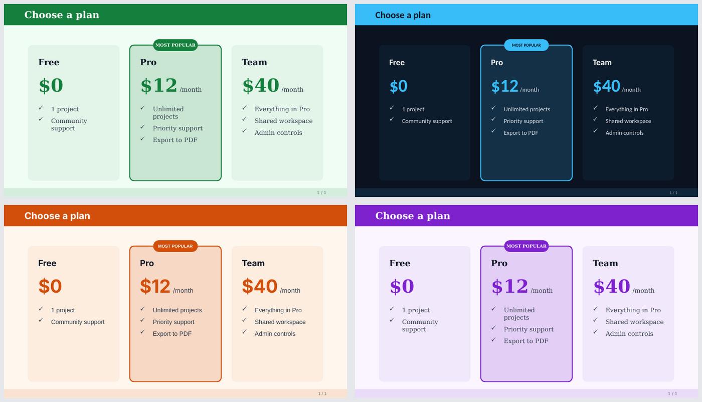
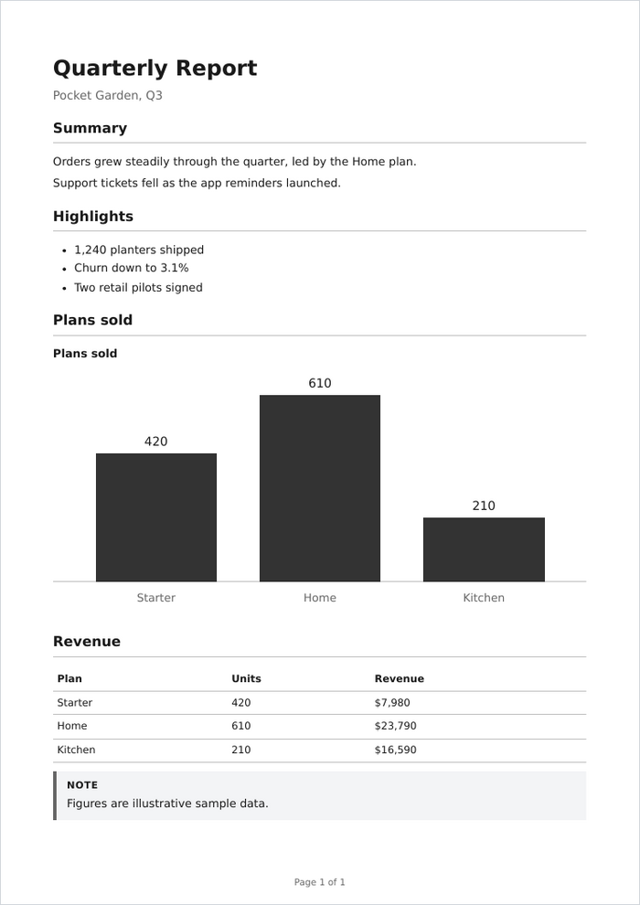

# ail-files

Turn JSON into **PowerPoint, PDF, Word and Excel** files. Add your own slide layouts and themes with a small pull request.

It is the file engine behind [Ail](https://ailighthouse.in), now open so anyone can improve how the files look.



## Try it

Needs Node 20 or newer. The PDF output also needs a Chromium browser (see [PDF](#pdf)).

```bash
npm install
npm run build

node dist/cli.js build examples/deck.json   -o deck.pptx
node dist/cli.js build examples/report.json -o report.pdf
node dist/cli.js build examples/report.json -o report.docx
node dist/cli.js build examples/budget.json -o budget.xlsx
```

The type of file comes from the name you give `-o`. Add `--theme midnight` to change how a deck looks.

## The commands

| Command | What it does |
| --- | --- |
| `build <input.json\|-> -o <file>` | Make a file. `-` reads the JSON from standard input. `--type pptx\|pdf\|docx\|xlsx` overrides the extension. |
| `example <pptx\|pdf\|docx\|xlsx>` | Print a full example of the JSON for that type. |
| `preview <layout> -o <file.pptx>` | Make a one-slide deck of a layout's example. Use it while writing a layout. |
| `import-theme <deck.pptx> -o <theme.json>` | Read the colors and fonts out of a PowerPoint file. See [Themes](#themes). |
| `themes` / `layouts` | List what is installed. |

## Use it from code

```ts
import { normalizeDeck, buildPptx, getTheme, applyTheme } from "ail-files";

const deck = normalizeDeck(json); // cleans the input, never throws; null if it is not a deck
if (deck) {
  const themed = applyTheme(deck, getTheme("forest")!);
  const bytes = await buildPptx(themed); // a Buffer with the .pptx
}
```

Every file type has a `normalize…` function (turns messy or AI-written JSON into something safe to draw) and a `build…` function. The normalizers are written to be forgiving: a bad slide loses its fancy layout, not its place in the deck.

## Slide layouts

Built in: `bullets`, `stat`, `comparison`, `quote`, `section`, `table`, `chart`, `grid`, `ranked`, `timeline`, `columns`, `problem_solution`, `team`, `iconlist`, `funnel`, `stats_row`, `process`, `recommendation`, `canvas`, `thank_you`, `presenter`, `hero`, `tiers`, `recap`, `glossary`, `roadmap`, `matrix`, `flowchart`, `calendar`, `gallery`, `quote_carousel`, `advanced_table`.

Community layouts live in [`src/layouts/`](src/layouts). One ships as an example: `pricing`.



**To add yours**, copy `src/layouts/pricing.ts`, change it, and list it in `src/layouts/index.ts`. See [CONTRIBUTING.md](CONTRIBUTING.md).

## Themes

A theme is a small JSON file in [`themes/`](themes): a background, an accent, and fonts.

```json
{ "name": "midnight", "description": "Deep navy with a bright sky-blue accent.", "background": "0B1220", "accent": "38BDF8", "fontPair": "modern" }
```



Text colors are never part of a theme. The engine picks them from the background so text is always readable, so a theme cannot make a deck unreadable.

### Make a theme from a PowerPoint file

```bash
node dist/cli.js import-theme brand.pptx -o themes/brand.json
```

This reads only the file's **color scheme and fonts**. Slides, text, images, logos and notes are never read or copied. The result is a few lines of JSON you can review before you commit it. Files over 50 MB, or with a theme part over 2 MB, are refused.

Importing a theme does not import the template's slide designs. A new look for a layout is a layout, written as code.

## PDF

PDFs are drawn as HTML and printed by a headless Chromium. Set `PDF_CHROMIUM_PATH` to a Chromium or Chrome binary, or have `chromium` on your `PATH`.



The page is locked down. JavaScript is off, and every request except `data:` and `about:` is refused, so a document cannot make the renderer fetch a file or call a server. This is tested against a local server in `test/pdfSecurity.test.ts`. See [SECURITY.md](SECURITY.md).

## Development

```bash
npm install
npm test          # unit tests, the PDF lockdown test and the CLI tests
npm run typecheck
npm run build
```

The PDF tests skip themselves if no Chromium is found.

## License

[Apache-2.0](LICENSE). Contributions are accepted under the same license.
