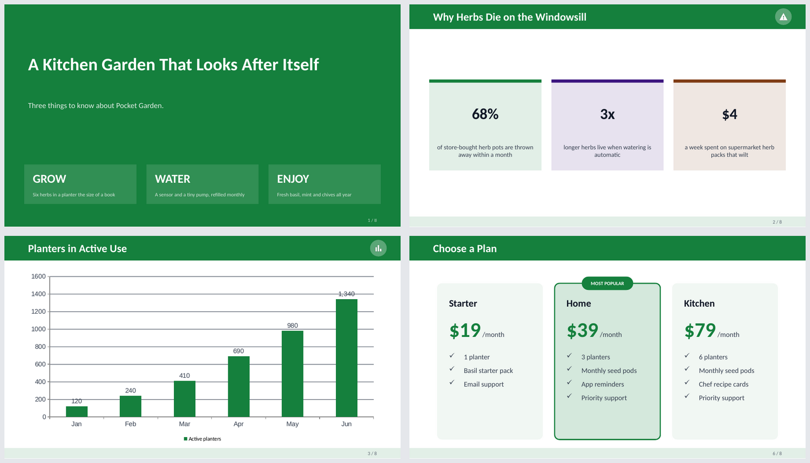
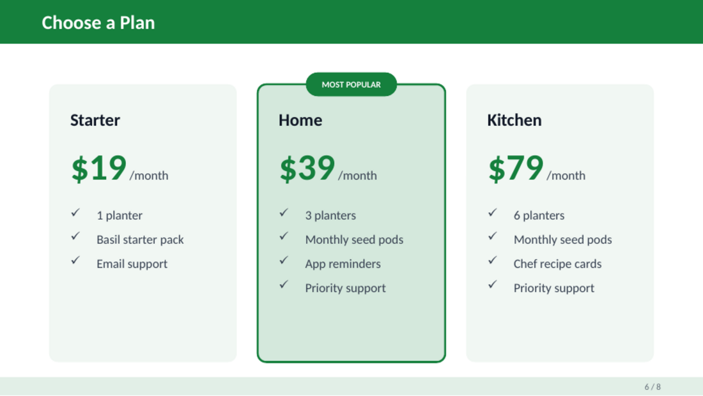
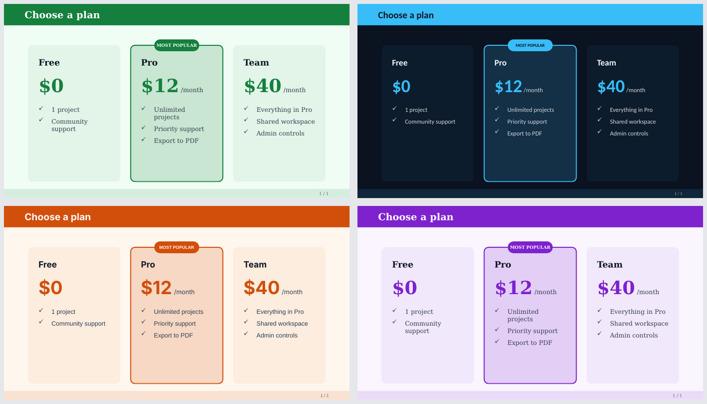
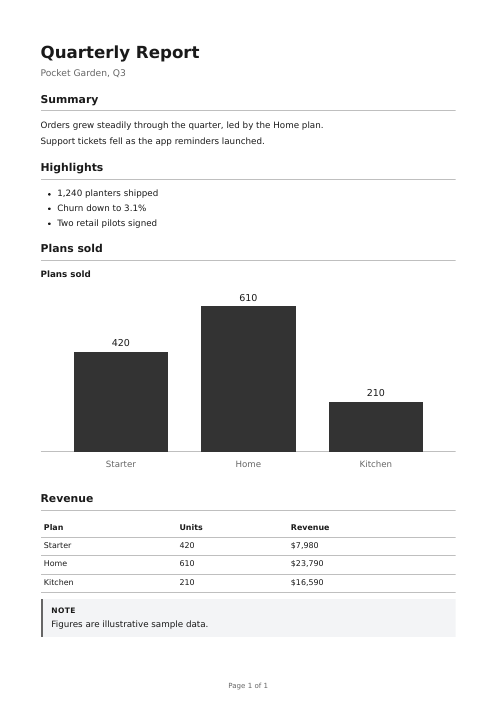

# ail-files

Turn JSON into **PowerPoint, PDF, Word and Excel** files. Add your own slide layouts and themes with a small pull request.

It is the file engine behind [Ail](https://ailighthouse.in), now open so anyone can improve how the files look.



## Try it

Needs Node 20 or newer to use (Node 22.12 or newer to run the tests). The PDF output also needs a Chromium browser (see [PDF](#pdf)).

```bash
npm install
npm run build

node dist/cli.js build examples/deck.json   -o deck.pptx
node dist/cli.js build examples/report.json -o report.pdf
node dist/cli.js build examples/report.json -o report.docx
node dist/cli.js build examples/budget.json -o budget.xlsx
```

The type of file comes from the name you give `-o`. Add `--theme midnight` to change how a deck looks.

## The commands

| Command | What it does |
| --- | --- |
| `build <input.json\|-> -o <file>` | Make a file. `-` reads the JSON from standard input. `--type pptx\|pdf\|docx\|xlsx` overrides the extension. |
| `example <pptx\|pdf\|docx\|xlsx>` | Print a full example of the JSON for that type. |
| `preview <layout> -o <file.pptx>` | Make a one-slide deck of a layout's example. Use it while writing a layout. |
| `import-theme <deck.pptx> -o <theme.json>` | Read the colors and fonts out of a PowerPoint file. See [Themes](#themes). |
| `themes` / `layouts` | List what is installed. |

## Use it from code

```ts
import { normalizeDeck, buildPptx, getTheme, applyTheme } from "ail-files";

const deck = normalizeDeck(json); // cleans the input, never throws; null if it is not a deck
if (deck) {
  const themed = applyTheme(deck, getTheme("forest")!);
  const bytes = await buildPptx(themed); // a Buffer with the .pptx
}
```

Every file type has a `normalize…` function (turns messy or AI-written JSON into something safe to draw) and a `build…` function. The normalizers are written to be forgiving: a bad slide loses its fancy layout, not its place in the deck.

## Your own logo and pictures

A deck can use the user's own pictures and a logo. Prepare them first (this checks the type and size and reads the pixel size), then pass them as options:

```ts
import { buildPptx, prepareImages, prepareLogo } from "ail-files";

const images = await prepareImages({ img1: "data:image/png;base64,..." }); // by id, img1...img8
const logo = await prepareLogo({ dataUrl: "data:image/png;base64,...", corner: "top-right", round: true });
const bytes = await buildPptx(deck, { images: images ?? undefined, logo: logo ?? undefined });
```

A slide names a picture by id: `{ "layout": "image", "image": "img1", "caption": "Our lighthouse" }`, `{ "layout": "photos", "items": [{ "image": "img1" }, { "image": "img2" }] }` or `{ "layout": "before_after", "before": { "image": "img1" }, "after": { "image": "img2" } }`. A deck can also set `"backgroundImage": "img3"` to use one picture behind every slide, and a free-form (`canvas`) slide can place pictures and give each piece of text its own `"color"`. A slide that names a picture that was not passed in says "Picture not available" instead of leaving a silent gap. `recordDeck(deck)` returns what was drawn on each slide as data, for building a preview in a browser. `features` lists the options this release has (`pptx.logo`, `pptx.images`).

## The editor

The editor you see in Ail is open too, so anyone can improve how decks are edited. It comes in two parts.

- **`ail-files/edit`** is plain code, no screen and no server: add, move, copy and delete slides, change a field, move and resize the parts of a free-form slide, undo history, the three-way merge for two people editing one deck, the conversion of a slide to free-form, the "ask the model to change this slide" prompt and reply parser, and the prompts that make a deck, PDF, Word or Excel file from a chat.
- **`ail-files/editor`** is the React editor: the slide strip, the live preview, a form for every layout, deck settings, the picture and look panels, drag handles on the slide, the ask box, undo and redo. It keeps no storage and no account. Everything that does comes from a `DeckEditorHost` you give it:

```tsx
import { DeckEditor, type DeckEditorHost } from "ail-files/editor";
import "ail-files/editor-tokens.css"; // the ten --ds-* colours it reads; or define the same variables in your own theme

const host: DeckEditorHost = {
  preview: async ({ deck, images, logo }) => (await fetch("/preview", { method: "POST", body: JSON.stringify({ deck, images, logo }) })).json(), // what recordDeck returns
  save: async (deck, baseVersion) => ({ status: "saved", version: baseVersion + 1 }),
  ask: async (args) => ({ error: "not connected" }),
  freeForm: async (args) => ({ error: "not connected" }),
  download: async ({ deck }) => ({ ok: false, error: "not connected" }),
  // optional: flush, poll, onRemoteChange, versions
};

<DeckEditor initialDeck={deck} initialVersion={1} host={host} pictures={[]} pictureMode="use" logo={{ enabled: false, corner: "top-right", round: false }} />;
```

If you use Tailwind, add `@source "../node_modules/ail-files/dist/editor";` to your CSS so it can see the editor's class names. `back`, `headerActions`, `notice`, `dialogs`, `busyMark` and `labels` (for example `assistantName`) let a program add its own buttons, dialogs and wording around the editor. The editor moves with a few shared behaviours (a pressed button sinks and springs back, a dragged slide lifts while the others slide aside, what opens eases out, a success tick draws itself); a program that wants the button press everywhere mounts `<PressEffect />` once, as the playground does. **To see it without writing a program,** run `npm install` and `npm run editor` in this repository and open http://localhost:5173: the editor on a page, with a small backend in [`playground/`](playground) that draws, saves, converts and downloads (set `ANTHROPIC_API_KEY` to try the ask box too). **Talk mode.** Where the browser can listen (Chrome, Edge and Safari), the ask box has a **Talk** button: press it and speak. Nothing is typed or shown as text: the box gives way to a calm voice bar, and from the first words the editor shows its mark (`busyMark`) animating over the slide, with "Listening…", then "Working on it…" while the slide changes. The sentence is sent after a short quiet spell (about 0.6 s once the browser itself marks it final, 1.3 s otherwise), and the microphone is held while the slide is being changed and picked up again straight afterwards, so the person can keep going. The request carries `fast: true` (see `AskArgs`), so a host can answer with a quicker model. While the slide is being changed it keeps talking so it feels active: a quick acknowledgement at once, then a short line every few seconds until the work is done (`narrateWhile` in `src/editor/voice.ts`). A host can supply a specific acknowledgement from a fast model with the optional `host.acknowledge(prompt)` ("Sure, making the title bigger."); if it is missing or slower than about a second, a generic line is said. Replies are spoken unless the person turns **Speak replies** off: it says what changed (`describeChange` in `ail-files/edit`, for example "Done. I changed the title.") or the problem. Browsers only let a page speak after a tap, so pressing Talk primes speech. Saying "stop" ends talk mode. The browser does the listening (`SpeechRecognition`), so nothing is installed and no audio reaches this package. The rules (the pause, holding, restarting a run the browser ended) are in `src/editor/voice.ts` and tested in `test/voice.test.ts`. `SlideAsk` takes a `slideKey` instead of being re-created per slide, so talk mode carries on when the person picks another slide, and reports its phase through `onVoicePhase`.

The editing code and the editor are tested here (`test/editor.test.ts` renders the whole editor from a stand-in host). Where each part lives, and the rules for changing it, are in [CONTRIBUTING.md](CONTRIBUTING.md#improve-the-editor).

## Slide layouts

Built in: `bullets`, `stat`, `comparison`, `quote`, `section`, `table`, `chart`, `grid`, `ranked`, `timeline`, `columns`, `problem_solution`, `team`, `iconlist`, `funnel`, `stats_row`, `process`, `recommendation`, `canvas`, `thank_you`, `presenter`, `hero`, `tiers`, `recap`, `glossary`, `roadmap`, `matrix`, `flowchart`, `calendar`, `gallery`, `quote_carousel`, `advanced_table`, `image`, `photos`, `before_after`.

Community layouts live in [`src/layouts/`](src/layouts). One ships as an example: `pricing`.



**To add yours**, copy `src/layouts/pricing.ts`, change it, and list it in `src/layouts/index.ts`. See [CONTRIBUTING.md](CONTRIBUTING.md).

## Themes

A theme is a small JSON file in [`themes/`](themes): a background, an accent, and fonts.

```json
{ "name": "midnight", "description": "Deep navy with a bright sky-blue accent.", "background": "0B1220", "accent": "38BDF8", "fontPair": "modern" }
```



Text colors are never part of a theme. The engine picks them from the background so text is always readable, so a theme cannot make a deck unreadable.

### Make a theme from a PowerPoint file

```bash
node dist/cli.js import-theme brand.pptx -o themes/brand.json
```

This reads only the file's **color scheme and fonts**. Slides, text, images, logos and notes are never read or copied. The result is a few lines of JSON you can review before you commit it. Files over 50 MB, or with a theme part over 2 MB, are refused.

Importing a theme does not import the template's slide designs. A new look for a layout is a layout, written as code.

## PDF

PDFs are drawn as HTML and printed by a headless Chromium. Set `PDF_CHROMIUM_PATH` to a Chromium or Chrome binary, or have `chromium` on your `PATH`.



The page is locked down. JavaScript is off, and every request except `data:` and `about:` is refused, so a document cannot make the renderer fetch a file or call a server. This is tested against a local server in `test/pdfSecurity.test.ts`. See [SECURITY.md](SECURITY.md).

## Development

```bash
npm install
npm test          # unit tests, the PDF lockdown test and the CLI tests
npm run typecheck
npm run build
```

The PDF tests skip themselves if no Chromium is found.

## License

[Apache-2.0](LICENSE). Contributions are accepted under the same license.
